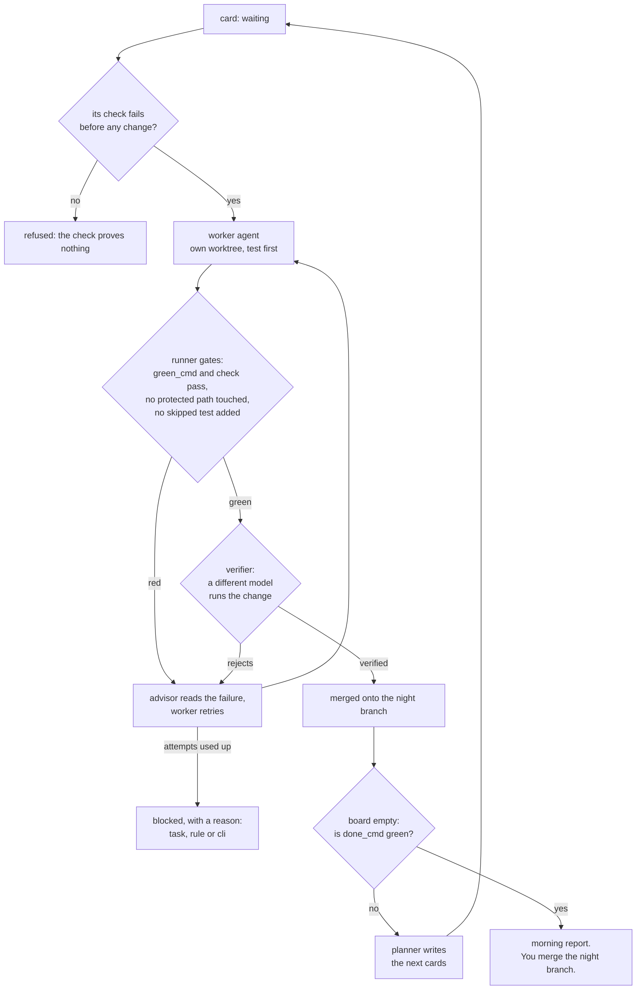

# apsolut-agents

[](https://github.com/apsolut/apsolut-agents/actions/workflows/ci.yml)
[](LICENSE)

Runs with:
 Claude Code
 Codex
 Grok


**Write task cards in the evening. Review verified branches in the morning.**

A drop-in folder of markdown and small shell scripts that lets the coding CLIs you
already have (Claude Code, Codex, Grok, Antigravity, …) work **one repo** together:
unattended through the night, or side by side during the day. A second model checks
every change before it counts. Nothing lands on your default branch until you merge it.

No server, no daemon, no framework. Markdown + git + POSIX sh (Git Bash on Windows).

> **Status: early.** Plain nights have run on a real project. The goal loop (v0.9+)
> is tested end to end in CI against a scripted stand-in agent, and has carried real
> models through one small night (the recording below). It has not yet run a long
> night on a large project. Start with one supervised card (`--once`).


_The morning after a real night: Claude Code wrote the code, Codex verified each card,
and the planner added the card the two hand-written ones had missed.
[The full report](docs/demo/night-report.md)._

## What you get

- **Night shift.** One runner per agent works a board of cards, each in its own git
  worktree, with a time cap, a spend cap and a circuit breaker.
- **A goal loop.** Give it a command that fails until the product is done. When the
  board runs dry and the command is still red, a planner writes the next cards.
- **An independent verifier.** A different model runs each change and returns a
  verdict. The author's "done" is treated as a claim.
- **Agents that drive agents.** Any agent can dispatch another agent's CLI on a card,
  watch it, correct it and decide. Caps are enforced by scripts.
- **One place to look.** One append-only log, one state file whose facts are derived
  from git so they cannot go stale, and a morning report that says what needs you.

## Quickstart

From inside your project:

```sh
curl -fsSL https://raw.githubusercontent.com/apsolut/apsolut-agents/main/install.sh | sh -s -- . --wire
```

Then:

1. In `.apsolut-agents/HEARTBEAT.md`, set `green_cmd:` to the command that means
   "this repo is healthy" (your tests, typecheck, lint).
2. Copy `.apsolut-agents/work/_TEMPLATE.md` to `work/T-01.md` and describe one small
   task. Give it a `check:` command that fails now and passes when the task is done.
3. Commit the folder, then run the preflight and one supervised card:

```sh
sh .apsolut-agents/scripts/doctor.sh claude          # tools, config, cards, a live probe of the CLI
sh .apsolut-agents/scripts/runner.sh claude --once   # one card through the whole pipeline
```

4. Read `.apsolut-agents/runs/night-<date>.md`, then merge what you accept:

```sh
sh .apsolut-agents/scripts/worktree.sh done T-01 --merge
```

When single cards are boring, drop `--once` and let it run the night.

## How a night works



Every step is a row in `runs/trail-<date>.tsv`, with a pointer to the evidence.

## What the morning looks like

The runner writes one report per night. This excerpt (trimmed) is real output from the test
suite, where a scripted agent's first attempt was rejected by the verifier and its
second attempt landed:

```
Ended: 2026-11-11 02:37 — reason: goal met — spend: $0.13 / $50

| card | status | verified      | integrated | attempts | branch          |
| T-01 | review | test-verified | yes        | 2        | agent/fake/T-01 |

## Waiting on you
(nothing)

## Attention
Call: 🟢 merge as is
```

The full report and its decision trail: [`docs/sample-night-report.md`](docs/sample-night-report.md).
For a night run by real models, see [`docs/demo/night-report.md`](docs/demo/night-report.md).

## The runner enforces; the prompts only explain

Every rule a script can check lives in `runner.sh`, not in a prompt:

- **Test first.** A card's `check:` must fail before the change and pass after.
- **The judge is off limits.** `protect:` paths (the tests behind the goal, the green
  script, CI config) cannot be changed by a card.
- **No symptom patches.** An added `.skip`, `@ts-ignore` or `eslint-disable` is red.
- **Exit 0 is not "finished".** A CLI that ends with a cancelled turn, a denied tool
  or an error is a failed attempt, whatever it exited with.
- **Lanes stay in their lane.** The default commands switch off each CLI's own
  subagents, so work stays inside the card clock and the spend ledger.
- **Risk picks the judge.** A card tagged `schema`, `money`, `pii` or `api-contract`
  goes to your strongest verifier and never lands on its own check alone.
- **A block says why.** Each blocked card records whether the work failed, a runner
  rule refused it, or the CLI never finished.
- **Agents cannot edit their own rules.** A change to the config, the prompts or the
  scripts during a run stops the night (the tamper canary). Any agent can stop the
  line (`andon.sh raise`); only you restart it.

Details: [`template/NIGHTSHIFT.md`](template/NIGHTSHIFT.md). History of each rule:
[`CHANGELOG.md`](CHANGELOG.md).

## Why this, and not…

- **…the agents and loops built into each CLI?** They work within one vendor, and the
  model that wrote the code also judges it. Here the verifier is a different model,
  and one time cap, one spend ledger and one trail cover every CLI you run.
- **…an orchestration server or framework?** There is nothing to host. The state is
  files in your repo: read it with `cat`, review it with `git diff`, delete it with
  `rm -r`.
- **…an agent in a `while` loop?** A loop has no independent check, no budget, no
  record of why it did what it did, and nothing that stops it from weakening the
  tests to get to green.

## Install

One-liner, no clone needed (from inside your project):

```
curl -fsSL https://raw.githubusercontent.com/apsolut/apsolut-agents/main/install.sh | sh -s -- . --wire
```

Pin a release with `--tag vX.Y.Z`. Add `--dry-run` to print every file it would
write plus the exact `CLAUDE.md` block, changing nothing. Alternatives:

```
sh install.sh <path-to-your-repo> --wire      # from a local clone
npx degit apsolut/apsolut-agents/template .apsolut-agents   # payload only, no refresh logic
```

**What `--wire` does to your `CLAUDE.md`:** it *appends* the bootstrap block from
`CLAUDE-SNIPPET.md` between `<!-- apsolut-agents:begin -->` and
`<!-- apsolut-agents:end -->`. It never rewrites or reorders existing content, and
it skips the file entirely if the begin marker is already there — so re-running is
safe. If neither `CLAUDE.md` nor `AGENTS.md` exists, it creates `CLAUDE.md`.
Omit `--wire` and you can paste the block yourself.

**No-exec install (sandboxed agents, restrictive permission policies):** the
installer is three file operations, all doable with plain copies — see
[`template/INSTALL.md` §1](template/INSTALL.md), which also gives the `diff -r`
command that proves a hand-rolled install matches the installer byte-for-byte.

Full instructions in [`template/INSTALL.md`](template/INSTALL.md). Upgrading later
needs nothing but the installed folder itself:

```
sh .apsolut-agents/scripts/upgrade.sh          # fetches latest, never touches your data
sh .apsolut-agents/scripts/upgrade.sh --dry-run   # show add/update/keep, write nothing
```

`kind=instance` files (your log, state, decisions, PROJECT.md, cards) survive every
upgrade; `VERSION` records what you're on. After an upgrade, run `doctor.sh`: your
`HEARTBEAT.md` is never rewritten, and doctor says which newer settings it lacks.

## The tier model

| Tier | Use when | Adds |
|---|---|---|
| **0 — Core** | any project, even solo | one log, one state file, agent charters, `status.sh` + `session-end.sh` |
| **1 — Long-run** | weeks-long work | protocol, decision register, `runs/` for subagent fan-outs, log archiving |
| **2 — Concurrent** | 2–3 agents, same day/same files | **git-worktree multiplexing** (`WORKTREES.md`, `worktree.sh`), **agent-drives-agent delegation** (`DELEGATION.md`, `delegate.sh`), **unattended nights** (`NIGHTSHIFT.md`, `runner.sh`, `doctor.sh`), cards from GitHub issues (`intake.sh`), work files, generated `STATUS.md` |

Start at Tier 0. Golden rule: don't build Tier 2 before concurrent edits actually hurt.

## How Tier-2 concurrency works (30 seconds)

```
sh .apsolut-agents/scripts/worktree.sh spawn grok T-014
```

gives agent *grok* an isolated checkout on branch `agent/grok/T-014`, with a
`.primary` pointer back to the one true coordination folder. The agent codes in
its worktree, talks in the shared log, and merges back through a normal git merge.
The log and state never fork — that's the whole trick. Spec: [`template/WORKTREES.md`](template/WORKTREES.md).

## Agents drive other agents (Tier 2)

Any agent in the roster can run any other agent's CLI as a subordinate worker and stay
in charge of it — Claude driving Grok, Grok driving Claude, either driving Codex or
Gemini. Symmetric by design.

```
sh .apsolut-agents/scripts/delegate.sh run grok T-014 --detach   # dispatch headless
sh .apsolut-agents/scripts/delegate.sh status                    # who's running, spend
sh .apsolut-agents/scripts/delegate.sh tail T-014                # live progress
sh .apsolut-agents/scripts/delegate.sh run grok T-014 --note "…" # correction round
sh .apsolut-agents/scripts/delegate.sh stop T-014                # kill + salvage-commit
```

Delegates run with whatever permission posture you put in `HEARTBEAT.md` — including
fully bypassed approvals, which is what makes headless rounds work at all. What keeps
that safe is structural, not a prompt: a delegate lives in its own worktree, its
remote push URL is sealed at spawn (`no_push://refused`, that worktree only), it
cannot merge, cannot write to the coordination folder, and cannot spawn delegates
of its own (depth cap). Do not put `claude --bare` on a `cmd_` line in
`HEARTBEAT.md`: that flag ignores the signed-in account, so the delegate reports
"Not logged in" while your own terminal is signed in. Every round is one unmerged branch and one `git diff` away from
being discarded. Rounds, fan-out, and daily spend are all capped; agents can't raise a
cap. Protocol: [`template/DELEGATION.md`](template/DELEGATION.md).

The unattended variant is the night shift above: same cards, same claim mutex, same
spend ledger, so the two never collide. [`template/NIGHTSHIFT.md`](template/NIGHTSHIFT.md).

## Run the night until the final product (goal loop)

Write what "done" means as a command that can fail, in `GOAL.md`:

```
goal: a signed-in user can export their library as a zip
done_cmd: pnpm --filter web e2e journeys/export.spec.ts
```

Verified cards merge onto one **night branch**, and later cards build on it. When
the board runs dry, the runner checks `done_cmd` there. If it is red, a **planner**
writes the next cards from the gap. The night ends when the goal is met, the planner
says a human is needed (`STUCK.md`), two rounds in a row land nothing (plateau), or a
cap trips. In the morning, a **reviewer** puts an *Attention* section at the top of
the night report, and one `worktree.sh done NIGHT-<date> --merge` lands the night.
The default branch never moves on its own.

## Cards from GitHub issues

```
sh .apsolut-agents/scripts/intake.sh
```

turns every open issue carrying the label `agents` into a draft card. The label is
your approval, and drafts arrive on hold for you to read and release. Anything that
can open a labelled issue (an alert, a failed deploy, a teammate) can feed the board.

## Run the preflight first

`scripts/doctor.sh <agent>` checks everything in one command: tools, config, every
card's contract and `after:` graph, green on a pristine worktree, rolling cost against
the budget, and a live probe of the agent's CLI. Then one supervised
`runner.sh <agent> --once` catches the misconfiguration that would otherwise burn the
whole night. The runner also probes the CLI on boot and refuses the lane if the
model cannot answer.

On a subscription plan the dollar figures are notional: nothing is charged per call,
and the budgets measure how fast you use your plan's window.

## This repo dogfoods itself

`.apsolut-agents/` at the root of this repo is a **live instance** of the template,
tracking the development of apsolut-agents itself — open it for a real, filled-in
example. `template/` is the pristine payload that `install.sh` copies; the two are
kept honest by the `kind=doc|instance|generated` labels on line 1 of every file.

## Layout

```
install.sh        installer / upgrader
template/         the payload — what lands in your repo as .apsolut-agents/
tests/            the night loop end to end against a fake agent CLI and a fake gh (CI runs it)
docs/             sample night report, demo recording script
.apsolut-agents/  this repo's own live workspace (dogfood)
```

Design lineage: the protocol was pruned against evidence from a real multi-week,
two-agent run — ceremony that agents skipped in practice was cut or automated;
facts that drifted when hand-written are now derived from git.

## License

MIT ([`LICENSE`](LICENSE)). Reuse, fork, sell — the one obligation is keeping the
copyright and license notice with copies. So that this survives partial reuse,
every script carries an SPDX header and installed workspaces ship their own copy
at `.apsolut-agents/LICENSE`; please keep the headers when lifting a single file.
Ideas parking lot: [`FUTURE.md`](FUTURE.md).
